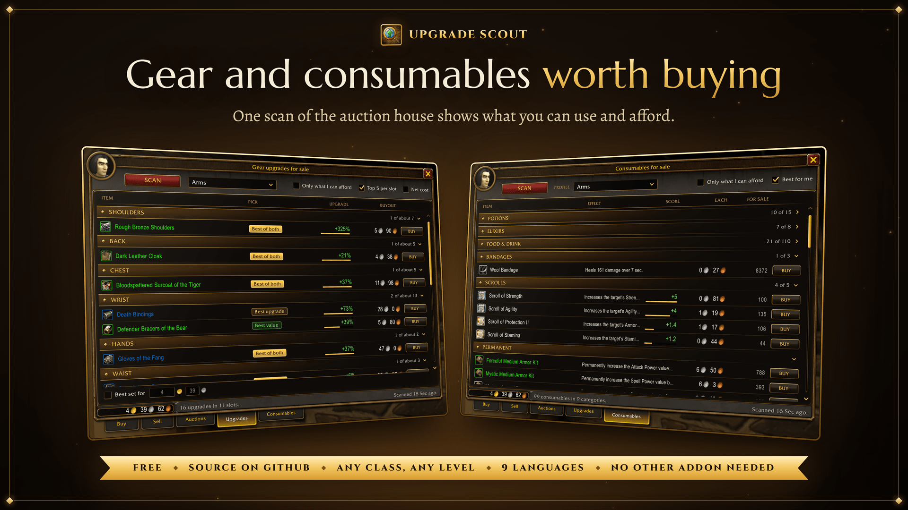
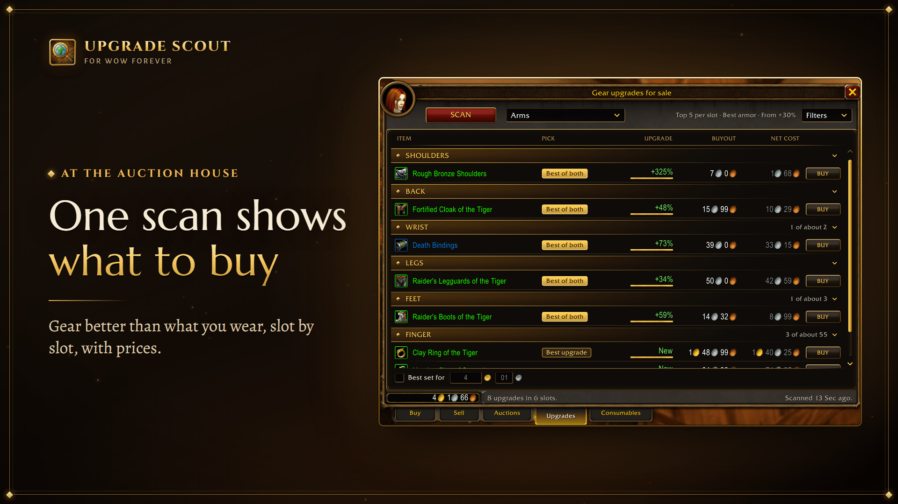
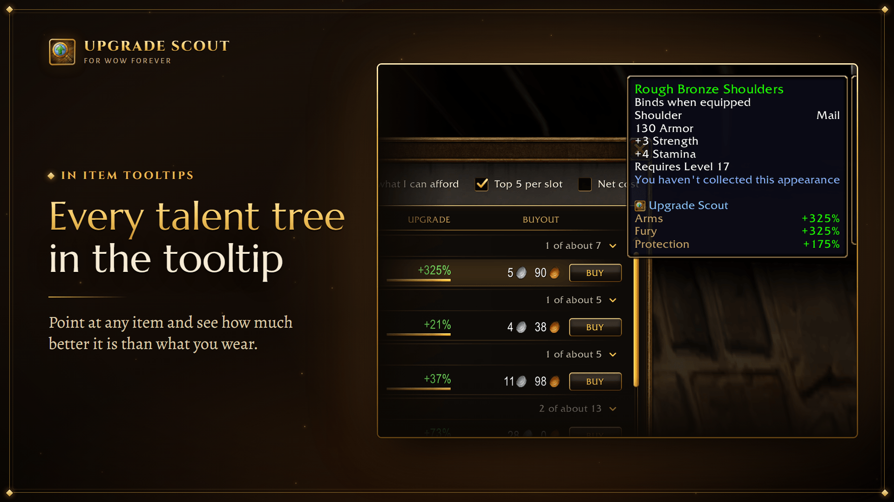
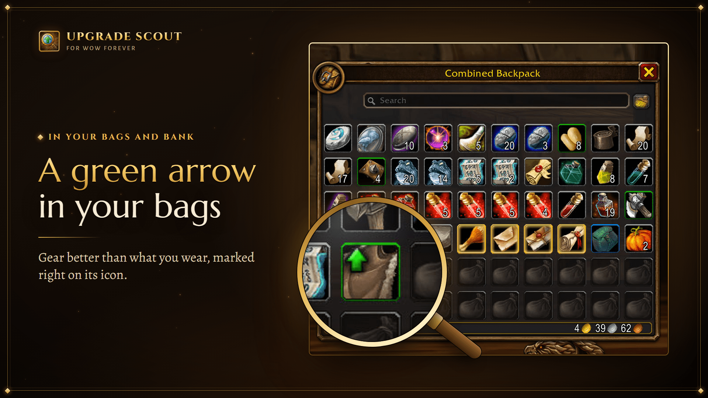
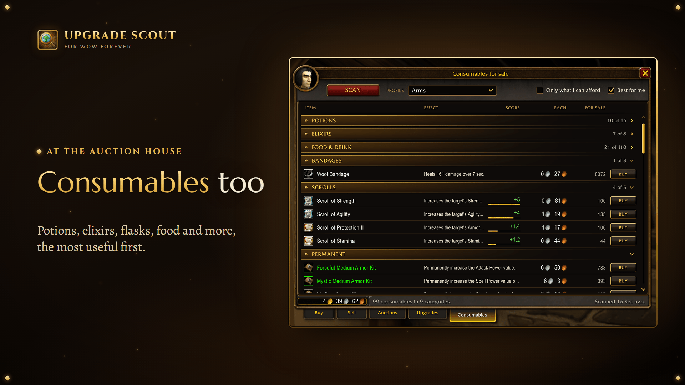
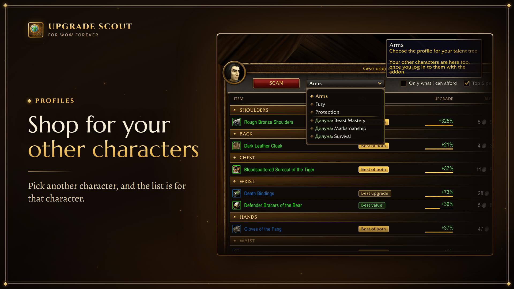
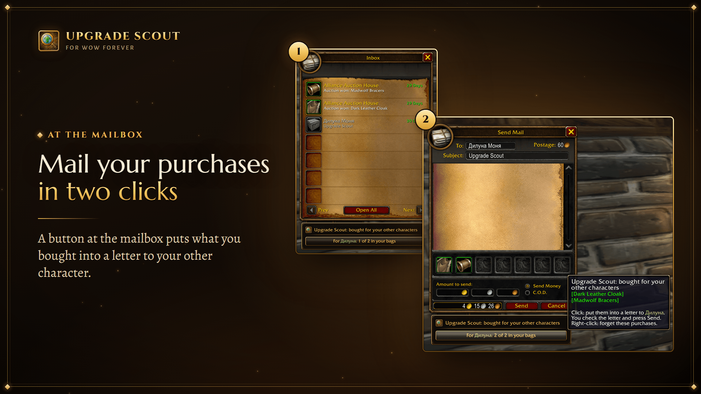
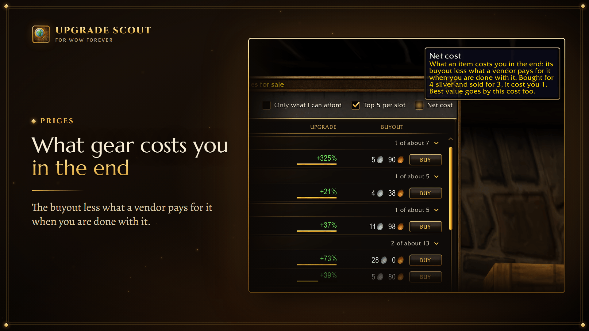
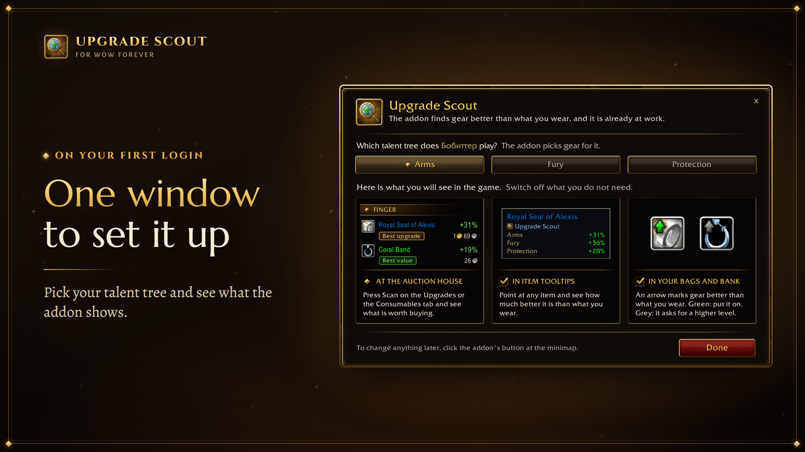

# Upgrade Scout

**Finds the gear upgrades and consumables on the auction house that you can use and afford.** An addon for World of Warcraft Forever.

**Download on [CurseForge](https://www.curseforge.com/wow/addons/upgrade-scout) or [Wago](https://addons.wago.io/addons/upgrade-scout)**

English · [简体中文](https://github.com/dibenkobit/upgrade-scout/blob/main/docs/README.zh-CN.md) · [繁體中文](https://github.com/dibenkobit/upgrade-scout/blob/main/docs/README.zh-TW.md) · [Deutsch](https://github.com/dibenkobit/upgrade-scout/blob/main/docs/README.de.md) · [Русский](https://github.com/dibenkobit/upgrade-scout/blob/main/docs/README.ru.md) · [Français](https://github.com/dibenkobit/upgrade-scout/blob/main/docs/README.fr.md) · [Español](https://github.com/dibenkobit/upgrade-scout/blob/main/docs/README.es.md) · [Português](https://github.com/dibenkobit/upgrade-scout/blob/main/docs/README.pt-BR.md) · [한국어](https://github.com/dibenkobit/upgrade-scout/blob/main/docs/README.ko.md)

---

Open the auction house, click the **Upgrades** tab and press **Scan**. You get a list of gear that is
better than what you wear, slot by slot, with prices. Press **Buy** on the one you want.

The **Consumables** tab does the same for potions, elixirs, flasks, food, bandages and oils. It
lists the ones your character can use and scores what each one adds. **Best for me** keeps one of
each kind: the one that gives you the most, at its lowest price.

Away from the auction house, the tooltip of any item shows how much better it is than what you
wear: in your bags, in loot, in a quest reward and in a chat link.

## What it does

- The scan shows only what you can equip right now and can pay for.
- The **Consumables** tab lists potions, elixirs, flasks, food, bandages and oils you can use, the
  most useful for your character first. What is of no use to you is left out.
- Marks two items in every slot: the **Best upgrade** is the strongest, the **Best value** is the
  cheapest per point of improvement.
- **Net cost** prices gear at what it costs you in the end: the buyout less what a vendor pays
  for it when you are done with it. Bought for 4 silver and sold for 3, it cost you 1.
- **Best set for** picks the upgrades that give the most together for your gold, or for a sum you type.
- Shops for your other characters too. A button at the mailbox puts the gear you bought into a
  letter to them.
- Any item's tooltip shows how much better it is than what you wear, for every spec of your class,
  such as Arms, Fury and Protection for a warrior.
- A green arrow on the icon of an item in your bags or bank means it is an upgrade you can put
  on now. A grey one: an upgrade once you reach its level.
- Works right after you install it. The **Profile** dropdown starts on the talent tree you have
  the most points in.
- A window on your first login shows what the addon does. There you can switch off the tooltip
  lines and the bag arrows. The addon's button at the minimap opens it again.
- Scores gear with its own stat weights for every talent tree, worked out with the
  [wowsims/forever](https://github.com/wowsims/forever) simulator. No other addon is needed.
- Use Pawn? Choose **Pawn** in the addon's window, and gear is scored on your Pawn scales, not on
  the addon's weights. The lists and the bag arrows go by them, and the tooltip lines are Pawn's own.

Any class, any level. English, Chinese (Simplified and Traditional), German, Russian, French,
Spanish, Brazilian Portuguese and Korean.

## Install

**Install from [CurseForge](https://www.curseforge.com/wow/addons/upgrade-scout) or [Wago](https://addons.wago.io/addons/upgrade-scout)**

The CurseForge or Wago app does it all for you.

You need World of Warcraft Forever (1.60.1). No other addon is needed.

To install by hand:

1. Download `UpgradeScout-<version>-forever.zip` from [CurseForge](https://www.curseforge.com/wow/addons/upgrade-scout), [Wago](https://addons.wago.io/addons/upgrade-scout)
   or from [GitHub releases](https://github.com/dibenkobit/upgrade-scout/releases).
2. Unpack it into `World of Warcraft\_forever_\Interface\AddOns`.
3. Restart the game.

## Good to know

- An item's score is the sum of its stats, each times its weight in your **Profile**. The profile
  starts on the talent tree you have the most points in. You can pick another in the dropdown.
- The weights are worked out for a level 60 character, so they are an approximation. Below 60,
  hit, crit, haste and expertise count for less, as simulations of leveling characters show.
- Stamina (except for tanks), and a healer's Intellect, Spirit and mana regeneration, are set by hand: a simulation of damage cannot tell what staying alive or running out of mana costs.
- Armor, shield block, defense, dodge and parry count on every profile: against Stamina, as much as they help the simulator's tank.
- A `~` after a profile's name means no simulation covers that tree yet and its weights are
  estimated.
- Prices are buyouts. Auctions that only take bids are skipped.
- With **Net cost** ticked, the price column and **Best value** go by the net cost. What you can
  afford, and **Best set for**, still go by the buyout: that is what you pay.
- **Top 5 per slot** keeps the list short. Turn it off to see every upgrade. The scan then takes
  longer, up to a few minutes on a busy auction house.
- **Upgrade** is how much better an item is than the one it replaces, in percent. **New** means
  the slot is empty. Points, such as `+6 pts`, mean what you wear there adds nothing on your profile.
- A yellow `*` after a name means the item has effects the score does not count, such as procs.
- Health and mana potions have no score: no weight puts a number on "restores 700 health".
- Boots "of the Tiger" and boots "of the Whale" are different items with different prices. The
  game's Sell tab shows all of them in one list, so the lowest price there can be for another item.

## Buying for another character

1. Log in to the other character once with the addon installed. The addon saves its gear, level
   and skills.
2. On the character at the auction house, pick the other character's profile in the **Profile**
   dropdown and press **Scan**.

The list is now for that character. The one you are playing still pays.

At a mailbox, take the gear you bought out of the mail. A button under the mail window then puts it
into a letter to that character. Check the letter and press **Send**. Consumables you send yourself.

The addon knows the other character as it was when you last played it. Log in to it again after it
levels up or changes gear.

## Commands

- `/upscout` opens the addon's window: what it does and its settings. At the auction house it
  opens the Upgrades tab.
- `/upscout stats` shows how long the last scan took.
- `/upscout stats` and an item (shift-click it into the chat line) shows each stat of the item,
  its weight in your profile and what they add up to.
- `/upscout forget Name` removes a deleted character from the dropdown.

## License

All rights reserved, see [LICENSE](https://github.com/dibenkobit/upgrade-scout/blob/main/LICENSE). The stat weights were worked out with
[wowsims/forever](https://github.com/wowsims/forever), and their share below level 60 with
[MythicSim's forever engine](https://github.com/sage3648/mythicsim-forever-engine). Both are under
the MIT license.

For developers: how to run the tests and make a release is in [DEVELOPMENT.md](https://github.com/dibenkobit/upgrade-scout/blob/main/docs/DEVELOPMENT.md).
